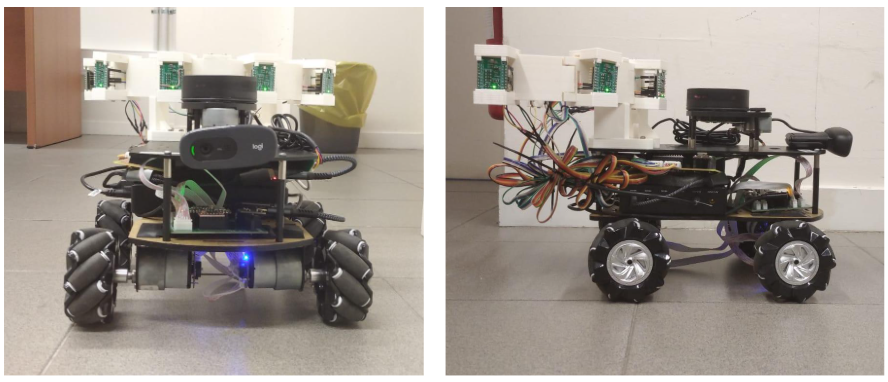
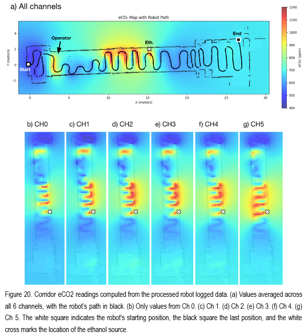

<h1 align="center">rUBot eCO₂ Indoor Mapping</h1>

<p align="center">
  
</p>

<p align="center">
  <b>Indoor air-quality mapping with a mecanum-wheeled mobile robot, SLAM and ENS160 gas sensors.</b>
</p>

<p align="center">
  
  
  
  
</p>

<p align="center">
  <a href="#overview">Overview</a> •
  <a href="#features">Features</a> •
  <a href="#requirements">Requirements</a> •
  <a href="#how-to-use">How to Use</a> •
  <a href="#nodes-and-topics">Nodes & Topics</a>
</p>

---

## Overview

**rUBot** is a ROS 2 Humble mobile robot with an array of **ENS160 gas sensors**. It combines SLAM and gas sensing so that every measurement is tied to a position on the map. You can watch eCO₂ levels live in RViz and generate concentration heatmaps offline.

<p align="center">
  
  <br>
  <em>Example result: eCO₂ concentration map of a corridor.</em>
</p>

## Features

| | Feature | Description |
|:-:|---|---|
| 🗺️ | **SLAM & navigation** | Indoor mapping and navigation with Cartographer and Nav2. |
| 🌫️ | **Gas sensing** | eCO₂, TVOC, AQI and sensor resistance readings. |
| 👁️ | **Live visualization** | Real-time eCO₂ point cloud in RViz. |
| 💾 | **Data logging** | CSV logging for stationary experiments and mobile gas mapping. |
| 🔥 | **Offline heatmaps** | Concentration maps generated with spatial interpolation. |

## Requirements

- 🐧 Ubuntu 22.04 with **ROS 2 Humble**
- 🤖 rUBot hardware and ENS160 sensors *(only for physical experiments)*
- 📦 The required workspace packages and dependencies

## How to Use

### 1. Connect to the robot

The Raspberry Pi is accessed remotely via SSH. The robot and your PC must be on the **same local WLAN**, with ROS 2 network discovery configured between them.

```bash
ssh <username>@<robot_ip>
```

> Replace `<username>` and `<robot_ip>` with the Raspberry Pi's username and IP address.

### 2. Build the workspace

After cloning the repository and obtaining its dependencies, build the workspace on the computer where the packages will run:

```bash
cd ~/ROS2_rUBot_mecanum_ws

source /opt/ros/humble/setup.bash

rosdep install --from-paths src --ignore-src -r -y

colcon build --symlink-install

source install/setup.bash
```

> [!TIP]
> In each new terminal, source the workspace before running ROS 2 commands.

### 3. Bring up the robot and generate a SLAM map

> [!NOTE]
> This step is only necessary when **creating or updating** the map. If you already have one, skip to [step 4](#4-launch-localization-using-the-saved-map).

**a) Robot bringup (automatic)**

When the robot is powered on, the Raspberry Pi automatically starts `my_robot_bringup_co2cloud_hw.launch.py`, which launches:

- the configured hardware drivers
- `robot_state_publisher`
- ENS160 acquisition
- the eCO₂ cloud node

**b) Start Cartographer**

Use the launch file provided in `my_robot_cartographer`.

> [!WARNING]
> The hardware bringup must already be running. Do **not** start duplicate hardware drivers.

**c) Drive and save the map**

Drive the robot through the environment while monitoring the map in RViz. Once the map is complete, save it:

```bash
ros2 run nav2_map_server map_saver_cli \
  -f ~/ROS2_rUBot_mecanum_ws/src/my_robot_navigation2/map/desired_map_name
```

This generates a `.yaml` file and its corresponding map image. Keep both files together and make sure the YAML references the correct image.

### 4. Launch localization using the saved map

Stop Cartographer once the map has been saved, but **keep the robot hardware running**. Then launch Nav2 with the saved map:

```bash
ros2 launch my_robot_navigation2 navigation2_robot.launch.py \
  use_sim_time:=false \
  map_file:=desired_map_name.yaml \
  params_file:=rubot_real_lidar.yaml
```

> [!IMPORTANT]
> The map must be installed in the package's configured `map` directory. If you generated a new map in the source directory, **rebuild the package** so the installed copy is updated.

### 5. Record and visualize eCO₂ measurements

Two nodes handle live data:

- **`sensor_pose_node_hw`** reads the ENS160 measurements and publishes them with odometry-derived pose on `/ens160_data`.
- **`eco2_cloud`** uses TF2 to place the measurements in the global `map` frame and publishes `/eco2_cloud`.

**Visualize in RViz**

1. Add a **PointCloud2** display.
2. Select the topic `/eco2_cloud`.
3. Set the **Fixed Frame** to `map`.
4. Adjust point size and colour settings.

**Record to CSV**

Enable CSV logging with the `csv_logger_enabled` argument in the hardware bringup, or run the standalone logger if the bringup logger is not already handling the experiment:

```bash
ros2 run ens160_sensors csv_logger_co2cloud
```

> [!NOTE]
> **To stop recording:** press `Ctrl+C` in the terminal where the logger is running. This ends the current data acquisition session.

### 6. Generate the offline heatmap

1. Transfer the recorded CSV file to your external computer, if necessary.
2. Use the plotting scripts in [`src/my_robot_co2map/scripts/`](src/my_robot_co2map/scripts/).
3. Provide the **CSV** path and the corresponding **map YAML** path.

> [!TIP]
> Offline analysis does not require the robot or the ROS 2 network to be running.

## Nodes and Topics

| Node | Function |
|---|---|
| `sensor_pose_node_hw` | Reads ENS160 measurements and publishes sensor data with odometry-derived pose information. |
| `eco2_cloud` | Uses TF2 to place measurements in the `map` frame and publishes the point cloud. |
| `csv_logger` | Records sensor measurements **without** robot pose information. |
| `csv_logger_co2cloud` | Records sensor measurements **with** robot pose information for spatial mapping. |

| Topic | Published by | Purpose |
|---|---|---|
| `/ens160_data` | `sensor_pose_node_hw` | Sensor readings with pose information |
| `/eco2_cloud` | `eco2_cloud` | eCO₂ point cloud in the `map` frame, for RViz |
